# Jules Ecosystem Map — Skills, Runbooks, Docs, Tools & Connections

> **Historical topology snapshot:** Several paths and duplication counts in this map
> predate consolidation. Use [`../README.md`](../README.md) for current authorities;
> verify any path against the repository before following it.

## 1. Location Architecture (Where Everything Lives)

```
┌─────────────────────────────────────────────────────────────────────────────────┐
│                              GLOBAL / SYSTEM-WIDE                                │
│  ~/.agents/          ~/.jules/         ~/.gemini/extensions/    ~/.local/share/  │
│  tools/cli/ ~/.gemini/        mise/installs/           mise/shims/      │
└───────────────────────────┬─────────────────────────────────────────────────────┘
                            │
        ┌───────────────────┼───────────────────┐
        ▼                   ▼                   ▼
┌──────────────────┐ ┌──────────────────┐ ┌──────────────────┐
│  kaggle-notebooks │ │ gemini-fullstack  │ │  EmailIntelligence│
│    -analysis     │ │ -langgraph-quick  │ │                  │
│                  │ │    start          │ │                  │
│  .agents/skills/  │ │  .kilo/skill/     │ │  (root level)    │
│  commands/│ │  .kilo/commands/  │ │                  │
│  .jules/          │ │  .Jules/          │ │                  │
│  tools/           │ │  scripts/jules_   │ │                  │
│                   │ │    tools/         │ │                  │
│  docs/jules/      │ │                  │ │                  │
│  docs/runbooks/   │ │                  │ │                  │
└────────┬─────────┘ └──────────────────┘ └──────────────────┘
         │
         ▼
┌──────────────────┐
│  .chub-projects/  │
│  (mirror layer)   │
│  jules_sessions/  │
│  kaggle-notebooks │
│    -analysis/     │
│  data/ (×2)       │
└──────────────────┘
```

## 2. Component Inventory by Location

```
┌─────────────────────────────────────────────────────────────────────────────────────┐
│ GLOBAL (~/.agents/, ~/.gemini/, ~/.jules/, ~/.local/share/mise/)                    │
├─────────────────────────────────────────────────────────────────────────────────────┤
│                                                                                     │
│  SKILLS (2)                                                                         │
│  ├── ~/.agents/skills/jules-api/SKILL.md            ← REST API v1alpha reference    │
│  └── ~/.agents/skills/jules-session-manager/SKILL.md ← Session mgmt + PR correlation │
│                                                                                     │
│  COMMANDS (1)                                                                       │
│  └── tools/cli/jules-manager.py            ← Python CLI (list/send/approve) │
│                                                                                     │
│  CLI INFRASTRUCTURE                                                                 │
│  ├── ~/.local/share/mise/installs/npm-google-jules/0.1.42/bin/jules  ← CLI binary   │
│  ├── ~/.local/share/mise/shims/jules                                ← mise shim    │
│  ├── ~/.jules/config.yaml                                           ← global config │
│  └── ~/.jules/cache/                                                ← cache dir    │
│                                                                                     │
│  GEMINI EXTENSION (MCP Server)                                                      │
│  └── ~/.gemini/extensions/gemini-cli-jules/                                        │
│      ├── commands/jules.toml          ← agentic coding assistant prompt              │
│      ├── mcp-server/src/jules.ts      ← TypeScript MCP server source                │
│      ├── mcp-server/dist/jules.js     ← compiled MCP server                         │
│      └── mcp-server/node_modules/     ← @modelcontextprotocol/sdk, zod              │
│                                                                                     │
└─────────────────────────────────────────────────────────────────────────────────────┘

┌─────────────────────────────────────────────────────────────────────────────────────┐
│ kaggle-notebooks-analysis  (PRIMARY Jules TOOLING HUB)                              │
├─────────────────────────────────────────────────────────────────────────────────────┤
│                                                                                     │
│  SKILLS (2)                                                                         │
│  ├── .agents/skills/jules-session-manager/SKILL.md  ← ENHANCED copy (more triggers) │
│  └── .agents/skills/wrapup-session/SKILL.md          ← session wrap-up + QA status  │
│                                                                                     │
│  SHELL COMMANDS (10)                                                                │
│  ├── commands/jules-list              → calls jules_list_sessions.py        │
│  ├── commands/jules_triage.sh         → calls jules_list_sessions.py        │
│  ├── commands/jules_audit.sh          → calls jules_audit_session_pr.py     │
│  ├── commands/jules_recover.sh        → calls jules_send_message.py         │
│  ├── commands/jules_pr_context.sh     → calls jules_pr_context.py           │
│  ├── commands/jules_discovery.sh      → lists available commands            │
│  ├── commands/jules-triage-activities → triage session activities           │
│  ├── commands/jules-triage-analyze    → analyze triage results              │
│  ├── commands/jules-triage-list       → list triage items                   │
│  └── commands/jules-triage-recover    → recovery from triage                │
│                                                                                     │
│  PYTHON TOOLS (17)                        tools/                      │
│  ├── api/jules_api_client.py      ← class-based REST client + backoff               │
│  ├── sessions/jules_list_sessions.py    ← list + A+ grading                         │
│  ├── sessions/jules_list_activities.py  ← session chat history                      │
│  ├── sessions/jules_monitor.py          ← background daemon + PID lock              │
│  ├── sessions/jules_recovery_manager.py ← state-based recovery                      │
│  ├── pr/jules_audit_session_pr.py       ← automated safety audit                    │
│  ├── sessions/jules_approve_plan.py     ← approve pending plan                       │
│  ├── sessions/jules_send_message.py     ← send message to unblock                   │
│  ├── pr/jules_pr_context.py             ← PR context extraction                     │
│  ├── rebase/jules_rebase_orchestrator.py ← safe rebase + merge-tree + pytest        │
│  ├── multi_repo/jules_multi_repo.py     ← multi-repo session mgmt                   │
│  ├── sessions/analyze_unanswered.py     ← detect waiting-for-user state             │
│  ├── sessions/config.py                 ← shared configuration                      │
│  ├── shell/check_all_repos.sh           ← multi-repo consistency check              │
│  ├── tests/test_jules_api.sh            ← API connection health check (shell)       │
│  ├── tests/test_api_connection.py       ← API connection health check (Python)      │
│  └── tests/test_all_features.py         ← full feature test suite                   │
│                                                                                     │
│  RUNBOOKS (5)                             docs/jules/                               │
│  ├── JULES_SESSION_RUNBOOK.md     ← daily triage workflow + recovery playbook       │
│  ├── JULES_FAILURE_RUNBOOK.md     ← failure modes + sendMessage recovery           │
│  ├── JULES_PR_VERIFICATION_RUNBOOK.md ← safety audit + manual review checklist      │
│  ├── ORCHESTRATOR_RUNBOOK.md      ← triage-to-merge pipeline (5 stages)             │
│  └── RUNBOOK_IMPROVEMENT_LOG.md   ← change log                                     │
│                                                                                     │
│  AUXILIARY DOCS (8)                       docs/jules/                               │
│  ├── JULES_TOOLS_README.md        ← tools overview                                 │
│  ├── JULES_REST_API_REFERENCE.md ← REST API endpoint reference                     │
│  ├── MULTI_REPO_TOOLS.md          ← multi-repo tooling                              │
│  ├── extracted_bolt_role.md        ← extracted Bolt role prompt                     │
│  ├── extracted_sentinel_role.md    ← extracted Sentinel role prompt                 │
│  └── extracted_recovery_payloads.json ← recovery payload templates                 │
│                                                                                     │
│  SKILLS REFERENCES (5)                  skills/jules-sessions/references/            │
│  ├── prompts.md                     ← formatted Jules prompts (8.8KB)               │
│  ├── response_templates.md          ← response template patterns                     │
│  ├── sent_responses.md              ← logged sent responses                          │
│  ├── task_schedule.json             ← MCP schedule config (26KB)                     │
│  └── wip_analysis.md                ← work-in-progress analysis                      │
│  └── extracted_recovery_payloads.json ← recovery payload templates                 │
│                                                                                     │
│  GENERAL RUNBOOKS (4)                     docs/runbooks/                            │
│  ├── ARCHITECTURE.md              ← system architecture overview                   │
│  ├── AUTH_SETUP.md                ← authentication setup guide                     │
│  ├── GITHUB_INTEGRATION.md        ← GitHub integration config                       │
│  └── SESSION_RECOVERY.md          ← session recovery procedures                     │
│                                                                                     │
│  TOP-LEVEL DOCS (3)                                                                 │
│  ├── JULES_PR_HANDOFF.md          ← 31 PRs documented + failure signatures (HUGE)   │
│  ├── JULES_QUICKSTART.md          ← 60-second setup guide                           │
│  └── JULES_API_UPDATE.md          ← API client migration guide                       │
│                                                                                     │
│  PROJECT CONFIG                                                                     │
│  └── .jules/INSTRUCTIONS.md       ← 26KB behavioral instructions                    │
│                                                                                     │
└─────────────────────────────────────────────────────────────────────────────────────┘

┌─────────────────────────────────────────────────────────────────────────────────────┐
│ gemini-fullstack-langgraph-quickstart                                                │
├─────────────────────────────────────────────────────────────────────────────────────┤
│                                                                                     │
│  SKILLS (1)                                                                         │
│  └── .kilo/skill/jules-api/SKILL.md               ← COPY of global jules-api        │
│                                                                                     │
│  COMMANDS (1)                                                                       │
│  └── .kilo/commands/jules-manager.py              ← COPY of global jules-manager.py  │
│                                                                                     │
│  PYTHON TOOLS (2)                       tools/                        │
│  ├── pr/jules_pr_context.py                       ← PR context extraction           │
│  └── pr/jules_pr_triage.py                        ← PR triage automation            │
│                                                                                     │
│  PROJECT CONFIG (.Jules/)                                                           │
│  ├── TASKS.md        ← task definitions                                            │
│  ├── antigravity.md  ← Antigravity role                                             │
│  ├── bolt.md         ← Bolt role                                                   │
│  ├── palette.md      ← Palette role                                                │
│  └── sentinel.md     ← Sentinel role                                               │
│                                                                                     │
│  ARCHIVE                                                                            │
│  └── .JULES_ARCHIVE.md  ← archived Jules state                                     │
│                                                                                     │
└─────────────────────────────────────────────────────────────────────────────────────┘

┌─────────────────────────────────────────────────────────────────────────────────────┐
│ EmailIntelligence                                                                    │
├─────────────────────────────────────────────────────────────────────────────────────┤
│                                                                                     │
│  TOP-LEVEL DOCS (2)                                                                 │
│  ├── JULES_WIP_ANALYSIS.md   ← analysis of 5 completed + unfinished WIP tasks       │
│  └── jules_mcp_schedule.json ← MCP scheduling config                                │
│                                                                                     │
└─────────────────────────────────────────────────────────────────────────────────────┘

┌─────────────────────────────────────────────────────────────────────────────────────┐
│ gemini-cli-prompt-library                                                            │
├─────────────────────────────────────────────────────────────────────────────────────┤
│                                                                                     │
│  TOP-LEVEL DOCS (3)                                                                 │
│  ├── JOBS_FOR_JULES.md          ← task queue for Jules                              │
│  ├── JULES_ENHANCEMENT_TASKS.md ← enhancement tasks                                │
│  └── jules_commands.sh         ← shell command wrappers                            │
│                                                                                     │
└─────────────────────────────────────────────────────────────────────────────────────┘

┌─────────────────────────────────────────────────────────────────────────────────────┐
│ .chub-projects/  (MIRROR LAYER — 4 copies of kaggle runbooks)                       │
├─────────────────────────────────────────────────────────────────────────────────────┤
│                                                                                     │
│  jules_sessions/docs/          ← JULES_FAILURE, PR_VERIFICATION, ORCHESTRATOR,      │
│                                   TRIAGE runbooks                                   │
│  kaggle-notebooks-analysis/    ← JULES_FAILURE, PR_VERIFICATION, SESSION,           │
│    docs/jules/                   ORCHESTRATOR runbooks                               │
│  data/jules_sessions/docs/     ← mirror of jules_sessions/                          │
│  data/kaggle-notebooks-        ← mirror of kaggle-notebooks-analysis/               │
│    analysis/docs/jules/                                                             │
│                                                                                     │
└─────────────────────────────────────────────────────────────────────────────────────┘
```

## 3. Connection Map (What References What)

```
                    ┌──────────────────────────────────────────────────────────┐
                    │                   JULES REST API                         │
                    │            https://jules.googleapis.com/v1alpha           │
                    │   /sessions · /sessions/{id} · /sessions/{id}:sendMessage │
                    │   /sessions/{id}:approvePlan · /sessions/{id}/activities │
                    └──────┬──────────────┬──────────────┬─────────────────────┘
                           │              │              │
              ┌────────────┘              │              └────────────┐
              ▼                           ▼                           ▼
    ┌─────────────────┐          ┌─────────────────┐         ┌──────────────────┐
    │  jules-api      │          │ jules-manager.py│         │  Gemini MCP      │
    │  SKILL.md       │          │ (global + kilo) │         │  Server          │
    │  (×2 copies)    │          │ (×2 copies)     │         │  jules.ts        │
    │  = API reference│          │ = CLI wrapper    │         │  = MCP wrapper   │
    └────────┬────────┘          └────────┬────────┘         └────────┬─────────┘
             │                            │                           │
             │     ┌──────────────────────┘                           │
             │     │                                                  │
             ▼     ▼                                                  ▼
    ┌──────────────────────────────────────────────────────────────────────────┐
    │                    JulesAPIClient (jules_api_client.py)                    │
    │              Class-based REST client with exponential backoff             │
    │                   Located in: kaggle/tools/                 │
    └──────┬──────┬──────┬──────┬──────┬──────┬──────┬──────┬──────┬────────────┘
           │      │      │      │      │      │      │      │      │
           ▼      ▼      ▼      ▼      ▼      ▼      ▼      ▼      ▼
        ┌────┐┌─────┐┌─────┐┌─────┐┌─────┐┌─────┐┌─────┐┌─────┐┌──────┐
        │list││list ││mon- ││recov││audit││appr ││send ││pr_  ││multi │
        │sess││actv ││itor ││ery  ││sess ││ove  ││msg  ││ctx  ││repo  │
        │ions││ities││     ││mgr  ││_pr  ││plan ││     ││     ││      │
        └─┬──┘└──┬──┘└──┬──┘└──┬──┘└──┬──┘└──┬──┘└──┬──┘└──┬──┘└──┬───┘
          │       │      │      │      │      │      │      │      │
          ▼       ▼      ▼      ▼      ▼      ▼      ▼      ▼      ▼
    ┌──────────────────────────────────────────────────────────────────────┐
    │                    SHELL COMMANDS (kaggle/commands/)           │
    │                                                                      │
│  jules-list ──────→ sessions/jules_list_sessions.py                   │
│  jules_triage.sh ─→ sessions/jules_list_sessions.py (+ curl fallback)│
│  jules_audit.sh ──→ pr/jules_audit_session_pr.py (+ curl fallback)   │
│  jules_recover.sh → sessions/jules_send_message.py (+ curl fallback) │
│  jules_pr_context→ pr/jules_pr_context.py (+ gh CLI fallback)        │
    │  jules_discovery ─→ lists available commands                         │
    │  jules-triage-* ──→ triage activity/analyze/list/recover              │
    └──────────────────────────────────────────────────────────────────────┘
```

## 4. Runbook → Tool/Command Cross-Reference Map

```
┌────────────────────────────┐
│ JULES_SESSION_RUNBOOK      │
├────────────────────────────┤
│ Daily Triage Workflow:     │
│  ├─→ commands/     │
│  │     jules-list           │
│  ├─→ sessions/jules_monitor.py      │
│  │     (--daemon)           │
│  └─→ sessions/jules_recovery_mgr.py │
│                                                                              
│ Recovery Playbook:          
│  ├─→ sessions/jules_approve_plan.py  (PAUSED state)
│  ├─→ sessions/jules_send_message.py  (AWAITING_USER_FEEDBACK)
│  ├─→ sessions/analyze_unanswered.py  (check if waiting)
│  └─→ pr/jules_audit_session_   (COMPLETED state)
│        pr.py                
└─────────────┬──────────────┘
              │
              ▼
┌────────────────────────────┐
│ JULES_FAILURE_RUNBOOK       │
├────────────────────────────┤
│  ├─→ sessions/jules_list_activities  │
│  │     .py                           │
│  ├─→ sessions/jules_send_message.py  │
│  └─→ JULES_PR_HANDOFF.md   ←─── references for failure signatures
│                                                                              
│  Key patterns documented:   
│  • Stale Prompt Pattern     
│  • Commitment Escalation   
│  • "I'll Create the Stub"  
│  • Test Infra As Coverage  
│  • Two PRs, Same Bug       
└─────────────┬──────────────┘
              │
              ▼
┌────────────────────────────┐
│ JULES_PR_VERIFICATION       │
│ RUNBOOK                     │
├────────────────────────────┤
│  ├─→ pr/jules_audit_session_   │
│  │     pr.py                   │
│  └─→ shell/check_all_repos.sh  │
│                                                                              
│  Safety Triggers (blocking):
│  • Build artefacts (.pyc, __pycache__, dist/, build/)
│  • Shell variables ($PWD, $PROJECT_ROOT)
│  • Read-only files (analysis/*.ipynb)
│                                                                              
│  Quality Warnings:          
│  • Missing tests           
│  • Stub implementations (TODO, pass # stub)
└─────────────┬──────────────┘
              │
              ▼
┌────────────────────────────┐
│ ORCHESTRATOR_RUNBOOK        │
├────────────────────────────┤
│ Stage 1: Discovery          
│  └─→ commands/     
│        jules_triage.sh      
│        (--active-only)     
│                                                                              
│ Stage 2: Validation         
│  └─→ commands/     
│        jules_audit.sh       
│        <SESSION_ID>         
│                                                                              
│ Stage 3: Sequence Planning  
│  └─→ rebase/jules_rebase_          
│        orchestrator.py      
│        (--add)              
│                                                                              
│ Stage 4: Safe Rebase        
│  └─→ rebase/jules_rebase_          
│        orchestrator.py      
│        (--limit 1)          
│        + post-rebase pytest 
│                                                                              
│ Stage 5: Record Keeping     
│  ├─→ AUDIT_REPORT.md        
│  └─→ JULES_PR_HANDOFF.md    
└────────────────────────────┘
```

## 5. Skill → Tool Dependency Map

```
┌─────────────────────────────────────────────────────────────────────────────┐
│  jules-session-manager SKILL  (kaggle copy — ENHANCED)                      │
│  .agents/skills/jules-session-manager/SKILL.md                              │
├─────────────────────────────────────────────────────────────────────────────┤
│                                                                             │
│  Declared dependencies in frontmatter:                                      │
│    PyGithub, python-dotenv                                                  │
│                                                                             │
│  Declared tool access:                                                      │
│  ├── terminal                                                               │
│  ├── python3                                                                │
│  ├── tools/pr/session_pr_triage.py  ←── UNIQUE to kaggle copy         │
│  ├── tools/utils/auth_manager.py         ←── UNIQUE to kaggle copy         │
│  ├── tools/utils/pre_flight_check.sh    ←── UNIQUE to kaggle copy         │
│  └── tools/api/jules_api_client.py                                      │
│                                                                             │
│  References in body:                                                        │
│  ├── tools/sessions/jules_list_sessions.py  (×2)                           │
│  ├── tools/sessions/jules_list_activities.py (×2)                          │
│  └── tools/api/jules_api_client.py     (×1)                                │
│                                                                             │
│  Triggers (kaggle copy has MORE):                                           │
│  ├── jules session        ← shared with global copy                         │
│  ├── jules api            ← shared with global copy                         │
│  ├── inspect jules sessions  ← UNIQUE to kaggle copy                        │
│  ├── session-pr mapping     ← UNIQUE to kaggle copy                        │
│  └── /jules-triage        ← shared with global copy                         │
│                                                                             │
└─────────────────────────────────────────────────────────────────────────────┘

┌─────────────────────────────────────────────────────────────────────────────┐
│  jules-session-manager SKILL  (global copy — BASE)                          │
│  ~/.agents/skills/jules-session-manager/SKILL.md                            │
├─────────────────────────────────────────────────────────────────────────────┤
│                                                                             │
│  Declared tool access:                                                      │
│  ├── terminal                                                               │
│  └── python3                                                                │
│                                                                             │
│  References in body:                                                        │
│  ├── tools/session_pr_triage.py  ←── (different path!)       │
│  └── JULES_API_KEY                             (×3 references)             │
│                                                                             │
│  Triggers:                                                                  │
│  ├── jules session                                                          │
│  ├── jules api                                                              │
│  └── /jules-triage                                                          │
│                                                                             │
└─────────────────────────────────────────────────────────────────────────────┘

┌─────────────────────────────────────────────────────────────────────────────┐
│  jules-api SKILL  (BOTH copies are IDENTICAL)                               │
│  ~/.agents/skills/jules-api/SKILL.md                                        │
│  gemini-fullstack/.kilo/skill/jules-api/SKILL.md                            │
├─────────────────────────────────────────────────────────────────────────────┤
│                                                                             │
│  No tool dependencies — pure API reference documentation                   │
│                                                                             │
│  Documents:                                                                 │
│  ├── POST /sessions              ← create session                          │
│  ├── GET  /sessions              ← list sessions                           │
│  ├── GET  /sessions/{id}         ← get session (includes PR URLs)         │
│  ├── POST /sessions/{id}:sendMessage   ← unblock agent                   │
│  ├── POST /sessions/{id}:approvePlan   ← approve pending plan            │
│  └── GET  /sessions/{id}/activities ← session chat history               │
│                                                                             │
│  Auth: x-goog-api-key header, JULES_API_KEY env var                        │
│  Key URL: https://jules.google.com/settings#api                             │
│                                                                             │
└─────────────────────────────────────────────────────────────────────────────┘
```

## 6. Duplication & Overlap Map

```
COMPONENT                 GLOBAL          kaggle          gemini-fullstack   EmailIntel   gemini-cli
                         ~/.agents/      .agents/         .kilo/                           -prompt-lib
─────────────────────────────────────────────────────────────────────────────────────────────────────
jules-api SKILL.md         ──┬────────────────────────────┬──────────────────
  (IDENTICAL content)         │                           │ (exact copy)
                             │                           │
jules-session-manager        ──┬───────────┬──────────────
  SKILL.md (kaggle              │           │ (enhanced copy
   has MORE triggers +           │           │  with extra deps)
   script dependencies)         │           │
                                │           │
jules-manager.py            ──┬───────────────────────────┬──────────────────
  (Python CLI command,          │                          │ (near-identical
   near-identical)              │                          │  copy)
                                │                          │
jules_pr_context.py            │           ──┬────────────┬──────────────────
  (Python tool)                 │              │            │ (separate copy,
                                │              │            │  different repo)
                                │              │            │
jules_pr_triage.py             │              │            ──┬──────────────────
  (Python tool)                │              │              │ (unique to
                                │              │              │  gemini-fullstack)
                                │              │              │
─────────────────────────────────────────────────────────────────────────────────────────────────────

RUNBOOKS                    kaggle          .chub-projects/ (4 mirror copies)
                            docs/jules/     ┌─────────────┬──────────────────┐
                                            │             │                  │
                            ──┬─────────────┤             │                  │
JULES_FAILURE_RUNBOOK          │             │ jules_sessions│ kaggle-notebooks│
JULES_PR_VERIFICATION          │             │ /docs/        │ -analysis/docs/ │
ORCHESTRATOR_RUNBOOK           │             │              │  jules/          │
JULES_SESSION_RUNBOOK          │             │              │                  │
TRIAGE_RUNBOOK  (chub-only)                  │ data/ mirror │  data/ mirror   │
                              │             │ (×2)        │  (×2)            │
                              ▼             ▼             ▼                  ▼
                         (source of truth)  (mirror)     (mirror)           (mirror)
```

## 7. Full Connection Diagram (Mermaid)

```mermaid
graph TB
    %% ═══════════════════════════════════════════════════════
    %% EXTERNAL API
    %% ═══════════════════════════════════════════════════════
    API["Jules REST API<br/>jules.googleapis.com/v1alpha"]
    API --> |x-goog-api-key| API

    %% ═══════════════════════════════════════════════════════
    %% CLI INFRASTRUCTURE
    %% ═══════════════════════════════════════════════════════
    subgraph CLI["CLI Infrastructure (Global)"]
        MISE["mise install<br/>npm-google-jules@0.1.42"]
        BIN["jules binary<br/>~/.local/share/mise/installs/"]
        SHIM["jules shim<br/>~/.local/share/mise/shims/"]
        CFG["config.yaml<br/>~/.jules/"]
        CACHE["cache/<br/>~/.jules/"]
        MISE --> BIN --> SHIM
        BIN --> CFG
        BIN --> CACHE
    end

    %% ═══════════════════════════════════════════════════════
    %% GEMINI MCP EXTENSION
    %% ═══════════════════════════════════════════════════════
    subgraph GEM["Gemini Extension (MCP)"]
        EXT["gemini-cli-jules<br/>~/.gemini/extensions/"]
        TOML["commands/jules.toml<br/>agentic coding prompt"]
        MCP["mcp-server/src/jules.ts<br/>TypeScript MCP server"]
        MCPDIST["mcp-server/dist/jules.js<br/>compiled"]
        EXT --> TOML
        EXT --> MCP --> MCPDIST
        MCP --> |wraps| BIN
    end

    %% ═══════════════════════════════════════════════════════
    %% GLOBAL SKILLS
    %% ═══════════════════════════════════════════════════════
    subgraph GSKILL["Global Skills (~/.agents/skills/)"]
        JAPI_G["jules-api SKILL.md<br/>REST API reference"]
        JSM_G["jules-session-manager SKILL.md<br/>session mgmt + PR correlation"]
        JAPI_G -.-> |documents| API
        JSM_G -.-> |documents| API
    end

    %% ═══════════════════════════════════════════════════════
    %% GLOBAL COMMANDS
    %% ═══════════════════════════════════════════════════════
    subgraph GCMD["Global Commands (tools/cli/)"]
        JMGR_G["jules-manager.py<br/>Python CLI: list/send/approve"]
        JMGR_G --> |REST calls| API
    end

    %% ═══════════════════════════════════════════════════════
    %% KAGGLE SKILLS
    %% ═══════════════════════════════════════════════════════
    subgraph KSKILL["kaggle Skills (.agents/skills/)"]
        JSM_K["jules-session-manager SKILL.md<br/>ENHANCED: +triggers, +script deps"]
        WRAP["wrapup-session SKILL.md<br/>session summary + QA status"]
        JSM_K -.-> |documents| API
    end

    %% ═══════════════════════════════════════════════════════
    %% KAGGLE SHELL COMMANDS
    %% ═══════════════════════════════════════════════════════
    subgraph KCMD["kaggle Shell Commands (commands/)"]
        JLIST["jules-list"]
        JTRIAGE["jules_triage.sh"]
        JAUDIT["jules_audit.sh"]
        JRECOVER["jules_recover.sh"]
        JPRCTX["jules_pr_context.sh"]
        JDISC["jules_discovery.sh"]
        JTRI_ACT["jules-triage-activities"]
        JTRI_ANA["jules-triage-analyze"]
        JTRI_LST["jules-triage-list"]
        JTRI_REC["jules-triage-recover"]
    end

    %% ═══════════════════════════════════════════════════════
    %% KAGGLE PYTHON TOOLS
    %% ═══════════════════════════════════════════════════════
    subgraph KTOOLS["kaggle Python Tools (tools/)"]
        CLIENT["api/jules_api_client.py<br/>JulesAPIClient class + backoff"]
        LIST_SESS["sessions/jules_list_sessions.py<br/>A+ grading"]
        LIST_ACT["sessions/jules_list_activities.py<br/>chat history"]
        MONITOR["sessions/jules_monitor.py<br/>daemon + PID lock"]
        RECOVERY["sessions/jules_recovery_manager.py<br/>state-based recovery"]
        AUDIT["pr/jules_audit_session_pr.py<br/>safety audit"]
        APPROVE["sessions/jules_approve_plan.py<br/>approve pending plan"]
        SENDMSG["sessions/jules_send_message.py<br/>unblock agent"]
        PRCTX["pr/jules_pr_context.py<br/>PR context extraction"]
        REBASE["rebase/jules_rebase_orchestrator.py<br/>safe rebase + pytest"]
        MULTIREPO["multi_repo/jules_multi_repo.py<br/>multi-repo mgmt"]
        UNANSWERED["sessions/analyze_unanswered.py<br/>detect waiting state"]
        CONFIG["sessions/config.py"]
        CHECKALL["shell/check_all_repos.sh"]
        TESTAPI["tests/test_jules_api.sh"]
        TESTAPIPY["tests/test_api_connection.py"]
        TESTALL["tests/test_all_features.py"]
    end

    %% ═══════════════════════════════════════════════════════
    %% KAGGLE RUNBOOKS
    %% ═══════════════════════════════════════════════════════
    subgraph KRUN["kaggle Runbooks (docs/jules/)"]
        RB_SESS["JULES_SESSION_RUNBOOK.md<br/>daily triage + recovery"]
        RB_FAIL["JULES_FAILURE_RUNBOOK.md<br/>failure modes + sendMessage"]
        RB_PRV["JULES_PR_VERIFICATION_RUNBOOK.md<br/>safety audit + checklist"]
        RB_ORCH["ORCHESTRATOR_RUNBOOK.md<br/>triage-to-merge pipeline"]
        RB_LOG["RUNBOOK_IMPROVEMENT_LOG.md"]
    end

    %% ═══════════════════════════════════════════════════════
    %% KAGGLE DOCS
    %% ═══════════════════════════════════════════════════════
    subgraph KDOC["kaggle Top-Level Docs"]
        HANDOFF["JULES_PR_HANDOFF.md<br/>31 PRs + failure signatures"]
        QUICK["JULES_QUICKSTART.md<br/>60-second setup"]
        APIUPD["JULES_API_UPDATE.md<br/>migration guide"]
        INSTR[".jules/INSTRUCTIONS.md<br/>26KB behavioral rules"]
    end

    %% ═══════════════════════════════════════════════════════
    %% GEMINI-FULLSTACK
    %% ═══════════════════════════════════════════════════════
    subgraph GEMINI["gemini-fullstack-langgraph-quickstart"]
        JAPI_K["jules-api SKILL.md<br/>COPY of global"]
        JMGR_K["jules-manager.py<br/>COPY of global"]
        PRCTX_G["jules_pr_context.py<br/>PR context"]
        PRTRIAGE_G["jules_pr_triage.py<br/>PR triage"]
        JULES_DIR[".Jules/<br/>TASKS, antigravity, bolt,<br/>palette, sentinel"]
        JARCHIVE[".JULES_ARCHIVE.md"]
    end

    %% ═══════════════════════════════════════════════════════
    %% CHUB-PROJECTS MIRRORS
    %% ═══════════════════════════════════════════════════════
    subgraph CHUB[".chub-projects/ (4 mirror copies)"]
        CHUB_JS["jules_sessions/docs/<br/>4 runbooks"]
        CHUB_KNA["kaggle-notebooks-analysis/<br/>docs/jules/ 4 runbooks"]
        CHUB_DATA_JS["data/jules_sessions/docs/<br/>4 runbooks (mirror)"]
        CHUB_DATA_KNA["data/kaggle-notebooks-analysis/<br/>docs/jules/ 4 runbooks"]
    end

    %% ═══════════════════════════════════════════════════════
    %% CONNECTIONS: Shell Commands → Python Tools
    %% ═══════════════════════════════════════════════════════
    JLIST --> |calls| LIST_SESS
    JTRIAGE --> |calls| LIST_SESS
    JAUDIT --> |calls| AUDIT
    JRECOVER --> |calls| SENDMSG
    JPRCTX --> |calls| PRCTX

    %% ═══════════════════════════════════════════════════════
    %% CONNECTIONS: Python Tools → API
    %% ═══════════════════════════════════════════════════════
    CLIENT --> |REST calls| API
    LIST_SESS --> |uses| CLIENT
    LIST_ACT --> |uses| CLIENT
    MONITOR --> |uses| CLIENT
    RECOVERY --> |uses| CLIENT
    AUDIT --> |uses| CLIENT
    APPROVE --> |uses| CLIENT
    SENDMSG --> |uses| CLIENT
    PRCTX --> |uses| CLIENT
    REBASE --> |uses| CLIENT
    MULTIREPO --> |uses| CLIENT
    UNANSWERED --> |uses| CLIENT

    %% ═══════════════════════════════════════════════════════
    %% CONNECTIONS: Runbooks → Tools/Commands
    %% ═══════════════════════════════════════════════════════
    RB_SESS --> |references| JLIST
    RB_SESS --> |references| MONITOR
    RB_SESS --> |references| RECOVERY
    RB_SESS --> |references| AUDIT
    RB_SESS --> |references| APPROVE
    RB_SESS --> |references| SENDMSG
    RB_SESS --> |references| UNANSWERED

    RB_FAIL --> |references| LIST_ACT
    RB_FAIL --> |references| SENDMSG
    RB_FAIL --> |references| HANDOFF

    RB_PRV --> |references| AUDIT
    RB_PRV --> |references| CHECKALL

    RB_ORCH --> |references| JTRIAGE
    RB_ORCH --> |references| JAUDIT
    RB_ORCH --> |references| REBASE
    RB_ORCH --> |references| HANDOFF

    %% ═══════════════════════════════════════════════════════
    %% CONNECTIONS: Docs → Runbooks
    %% ═══════════════════════════════════════════════════════
    QUICK --> |references| RB_SESS
    QUICK --> |references| JLIST
    QUICK --> |references| TESTAPI
    QUICK --> |references| AUDIT
    QUICK --> |references| MONITOR
    QUICK --> |references| RECOVERY
    QUICK --> |references| APPROVE
    QUICK --> |references| SENDMSG

    APIUPD --> |documents| CLIENT

    %% ═══════════════════════════════════════════════════════
    %% CONNECTIONS: Skill → Tools
    %% ═══════════════════════════════════════════════════════
    JSM_K --> |depends on| CLIENT
    JSM_K --> |depends on| LIST_SESS
    JSM_K --> |depends on| LIST_ACT

    %% ═══════════════════════════════════════════════════════
    %% DUPLICATION LINKS (dashed red)
    %% ═══════════════════════════════════════════════════════
    JAPI_G -.-> |DUPLICATE| JAPI_K
    JSM_G -.-> |ENHANCED COPY| JSM_K
    JMGR_G -.-> |DUPLICATE| JMGR_K
    PRCTX -.-> |SEPARATE COPY| PRCTX_G

    RB_FAIL -.-> |MIRRORED ×4| CHUB_JS
    RB_PRV -.-> |MIRRORED ×4| CHUB_JS
    RB_ORCH -.-> |MIRRORED ×4| CHUB_JS
    RB_SESS -.-> |MIRRORED ×4| CHUB_KNA

    %% ═══════════════════════════════════════════════════════
    %% STYLING
    %% ═══════════════════════════════════════════════════════
    classDef skill fill:#4a9eff,color:#fff,stroke:#2196f3,stroke-width:2px
    classDef runbook fill:#ff9800,color:#fff,stroke:#f57c00,stroke-width:2px
    classDef tool fill:#4caf50,color:#fff,stroke:#388e3c,stroke-width:2px
    classDef cmd fill:#9c27b0,color:#fff,stroke:#7b1fa2,stroke-width:2px
    classDef doc fill:#607d8b,color:#fff,stroke:#455a64,stroke-width:2px
    classDef infra fill:#795548,color:#fff,stroke:#5d4037,stroke-width:2px
    classDef api fill:#f44336,color:#fff,stroke:#d32f2f,stroke-width:3px
    classDef mirror fill:#e0e0e0,color:#333,stroke:#bdbdbd,stroke-width:1px,stroke-dasharray: 5 5

    class JAPI_G,JAPI_K,JSM_G,JSM_K,WRAP skill
    class RB_SESS,RB_FAIL,RB_PRV,RB_ORCH,RB_LOG runbook
    class CLIENT,LIST_SESS,LIST_ACT,MONITOR,RECOVERY,AUDIT,APPROVE,SENDMSG,PRCTX,REBASE,MULTIREPO,UNANSWERED,CONFIG,CHECKALL,TESTAPI,TESTAPIPY,TESTALL,PRCTX_G,PRTRIAGE_G tool
    class JLIST,JTRIAGE,JAUDIT,JRECOVER,JPRCTX,JDISC,JTRI_ACT,JTRI_ANA,JTRI_LST,JTRI_REC,JMGR_G,JMGR_K cmd
    class HANDOFF,QUICK,APIUPD,INSTR,JULES_DIR,JARCHIVE doc
    class MISE,BIN,SHIM,CFG,CACHE,EXT,TOML,MCP,MCPDIST infra
    class API api
    class CHUB_JS,CHUB_KNA,CHUB_DATA_JS,CHUB_DATA_KNA mirror
```



## 8. Summary Statistics

| Category | Unique Items | Copies | Locations |
|---|---|---|---|
| **Skills (SKILL.md)** | 3 (jules-api, jules-session-manager, wrapup-session) | 5 | 3 (global, kaggle, gemini-fullstack) |
| **Shell Commands** | 11 (10 kaggle + 1 global) | 12 | 3 (global, kaggle, gemini-fullstack) |
| **Python Tools** | 18 (17 kaggle + 2 gemini-fullstack, 1 shared) | 19 | 2 (kaggle, gemini-fullstack) |
| **Runbooks** | 5 (session, failure, PR verification, orchestrator, log) | 21 | 5 (kaggle + 4 chub mirrors) |
| **General Runbooks** | 4 (architecture, auth, GitHub, recovery) | 4 | 1 (kaggle) |
| **Top-Level Docs** | 3 (PR handoff, quickstart, API update) | 3 | 1 (kaggle) |
| **Auxiliary Docs** | 8 (tools README, REST API ref, multi-repo, extracted roles, etc.) | 8 | 1 (kaggle) |
| **Project Configs** | 6 (INSTRUCTIONS.md, TASKS.md, 4 role files) | 6 | 2 (kaggle, gemini-fullstack) |
| **Cross-Repo Docs** | 5 (WIP analysis, MCP schedule, jobs, enhancement, commands) | 5 | 2 (EmailIntelligence, gemini-cli-prompt-library) |
| **CLI Infrastructure** | 5 (binary, shim, config, cache, Gemini extension) | 5 | 3 (mise, ~/.jules, ~/.gemini) |
| **Total** | **68 unique** | **109 copies** | **7 distinct locations** |

### Key Overlaps

| Overlap Type | Components | Impact |
|---|---|---|
| **Exact duplicate** | jules-api SKILL.md (global ↔ gemini-fullstack) | Identical content — no drift risk |
| **Enhanced copy** | jules-session-manager SKILL.md (global ↔ kaggle) | Kaggle copy has MORE triggers + script deps — drift risk |
| **Near-duplicate** | jules-manager.py (global ↔ gemini-fullstack) | Near-identical but different docstring paths — drift risk |
| **Separate copy** | jules_pr_context.py (kaggle ↔ gemini-fullstack) | Different repos, may diverge — drift risk |
| **4× mirror** | 5 runbooks (kaggle → chub-projects) | chub copies are non-text (binary/symlink) — may be stale |
